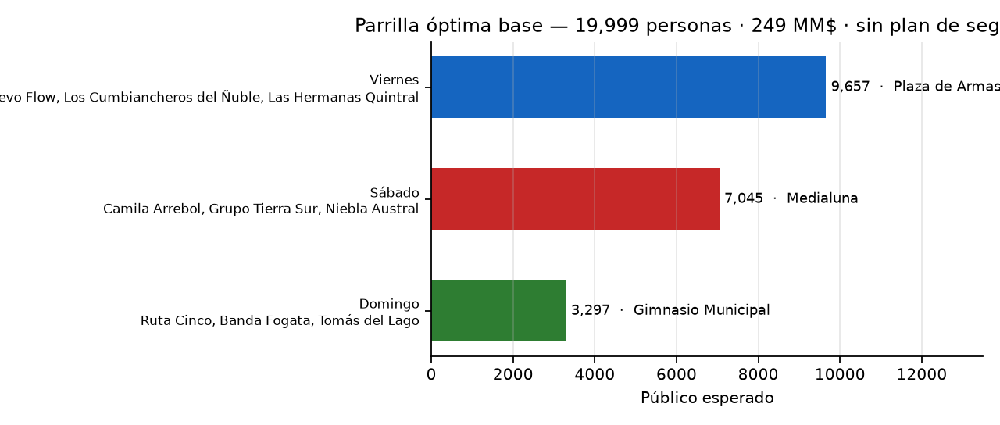
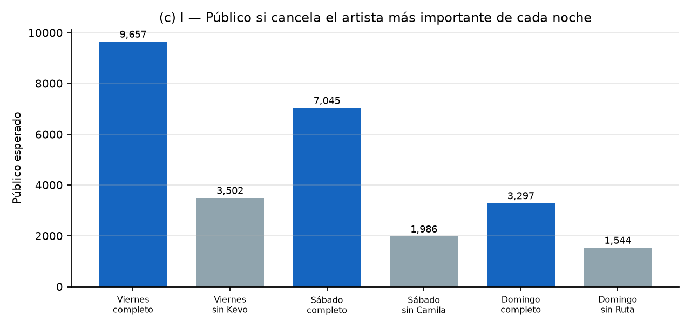
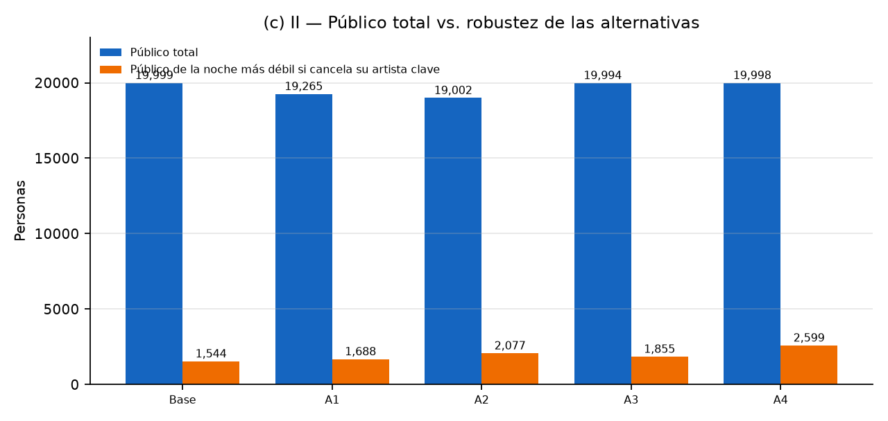
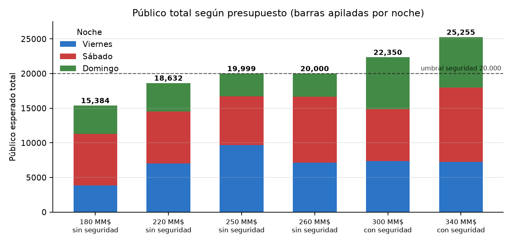
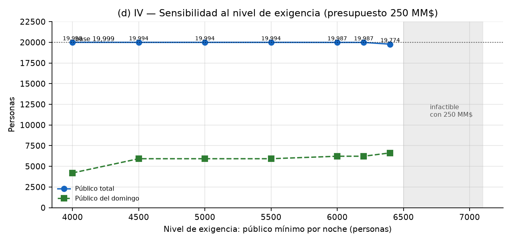

# Proyecto ING200 — Optimización 2026-2
## Fiesta de Verano de Villa Peumayén

**Informe de respaldo**

**Integrantes:** _(completar)_

---

## 0. Resumen de resultados

| | |
| :--- | :--- |
| **Público total esperado (base)** | **19.999 personas** |
| **Costo total** | **249 MM$** (193 artistas + 56 recintos) |
| **Plan de seguridad** | **No se requiere** (el público no supera las 20.000 personas) |

| Noche | Recinto | Artistas | Público |
| :--- | :--- | :--- | ---: |
| Viernes | Plaza de Armas | Kevo Flow (G), Los Cumbiancheros del Ñuble (M), Las Hermanas Quintral (M) | 9.657 |
| Sábado | Medialuna | Camila Arrebol (G), Grupo Tierra Sur (M), Niebla Austral (P) | 7.045 |
| Domingo | Gimnasio Municipal | Ruta Cinco (M), Banda Fogata (P), Tomás del Lago (P) | 3.297 |

---

## 1. Datos y convenciones

- **Noches** $\mathcal{N}=\{\text{Viernes},\text{Sábado},\text{Domingo}\}$, con factor de asistencia $\phi_V=0{,}90$, $\phi_S=1{,}00$, $\phi_D=0{,}85$.
- **Recintos** $\mathcal{R}$, con capacidad $K_r$ y costo de arriendo $c_r$ (MM$).
- **Artistas** $\mathcal{A}$ (15), con género, nivel, popularidad $p_a$, costo $w_a$ y noches disponibles.
- El público esperado de la noche $n$ en el recinto $r$ con el conjunto de artistas $c$ es

$$\text{Pub}(c,n,r)=\operatorname{round}\Big(\min\big\{\phi_n\,D(c),\;K_r\big\}\Big),$$

donde $D(\cdot)$ es exactamente la función `demanda()` entregada en `datos_festival.py`.
- Todos los montos están en millones de pesos (MM$).

---

## 2. Pregunta 1(a) — Formulación del modelo

### 2.1 Idea central: la demanda se evalúa *antes* de optimizar

La demanda $D(c)$ **no es aditiva**: depende de la interacción entre pares de artistas y del efecto arrastre de los artistas grandes. Sin embargo, el enunciado fija que **cada noche tiene exactamente tres artistas**. Eso hace que el conjunto de "programas posibles" para una noche sea **finito y pequeño**: todos los tríos de artistas.

En consecuencia, la demanda de un trío se puede **calcular a priori como un dato**, no como una variable. Si $c$ es un trío,

$$D(c)\ \text{es un número conocido}\quad\Longrightarrow\quad \text{Pub}(c,n,r)\ \text{es un parámetro conocido}.$$

El modelo entonces **elige paquetes** (trío, noche, recinto) ya valorizados. Toda la no linealidad del problema (producto de bases, ajuste de interacción, arrastre, mínimo con la capacidad) queda resuelta **al construir los parámetros**, y el modelo que ve el solver es lineal entero puro.

### 2.2 Conjuntos

| Conjunto | Definición |
| :--- | :--- |
| $\mathcal{A}$ | Artistas candidatos ($\|\mathcal{A}\|=15$) |
| $\mathcal{N}$ | Noches del festival ($\|\mathcal{N}\|=3$) |
| $\mathcal{R}$ | Recintos disponibles ($\|\mathcal{R}\|=3$) |
| $\mathcal{C}$ | Tríos de artistas que respetan las reglas estructurales |
| $\Omega$ | Asignaciones factibles: $\Omega=\{(c,n,r)\in\mathcal{C}\times\mathcal{N}\times\mathcal{R}\ :\ \text{todos los artistas de } c \text{ están disponibles la noche } n\}$ |

El conjunto $\mathcal{C}$ se construye excluyendo los tríos que violarían reglas que **no dependen de la noche**:

- **Regla del telonero:** si el trío contiene a La Sonora Copihue pero no a Banda Fogata, se descarta (ambos deben presentarse la misma noche, y la noche tiene exactamente un trío).
- Nota: la exclusión La Nena Real / Yisus Beat **no** se descarta aquí, porque es una regla a nivel de festival (ver restricción R4).

Quedan $|\mathcal{C}|=377$ tríos y $|\Omega|=3.156$ asignaciones (trío, noche, recinto) factibles.

### 2.3 Parámetros

| Parámetro | Significado |
| :--- | :--- |
| $\text{Pub}_{cnr}$ | Público esperado si el trío $c$ toca la noche $n$ en el recinto $r$: $\operatorname{round}(\min\{\phi_nD(c),K_r\})$ |
| $\text{Cost}_{cnr}$ | Costo directo: $\sum_{a\in c} w_a + c_r$ (artistas + arriendo) |
| $\text{Disp}_{cn}$ | $1$ si todos los artistas de $c$ están disponibles la noche $n$, $0$ si no |
| $U$ | Umbral del plan de seguridad: $20.000$ personas |
| $S$ | Costo del plan de seguridad: $25$ MM$ |
| $B$ | Presupuesto total: $250$ MM$ |
| $M$ | Constante de acotamiento: $M=3\cdot 12.000-20.000=16.000$ |

**Justificación de $M$:** el público total nunca puede exceder $3\times 12.000=36.000$ (tres noches en la Plaza de Armas), luego el exceso sobre el umbral nunca supera $36.000-20.000=16.000$. Con $M=16.000$ la restricción de seguridad es correcta y no recorta ninguna solución.

### 2.4 Variables de decisión

$$X_{cnr}\in\{0,1\}: \text{ vale 1 si el trío } c \text{ se presenta la noche } n \text{ en el recinto } r.$$
$$Y\in\{0,1\}: \text{ vale 1 si se implementa el plan de seguridad.}$$

### 2.5 Función objetivo

$$\max\ Z=\sum_{(c,n,r)\in\Omega}\text{Pub}_{cnr}\,X_{cnr}$$

### 2.6 Restricciones

**(R1) Exactamente un trío y un recinto por noche.**

$$\sum_{(c,n,r)\in\Omega}X_{cnr}=1 \qquad \forall n\in\mathcal{N}$$

*Significado:* cada noche hay una sola parrilla. Como $X$ indexa tríos (y todo trío tiene 3 artistas), esta restricción codifica simultáneamente **"exactamente tres artistas por noche"** y **"todos en el mismo recinto"**: no puede haber dos tríos en la misma noche ni dos recintos.

**(R2) Cada artista se presenta a lo más una vez en el festival.**

$$\sum_{(c,n,r)\in\Omega\,:\,a\in c}X_{cnr}\le 1 \qquad \forall a\in\mathcal{A}$$

*Significado:* máxima contratación única; impide repetir un artista en dos noches.

**(R3) Disponibilidad por noche.**

$$X_{cnr}\le \text{Disp}_{cn} \qquad \forall (c,n,r)\in\Omega$$

*Significado:* un trío solo puede tocar las noches en que **todos** sus integrantes están disponibles (por ejemplo, Kevo Flow no puede ir el domingo). En el código esta restricción se implementa filtrando el universo de variables a $\Omega$, lo que es exactamente equivalente.

**(R4) Exclusión La Nena Real – Yisus Beat.**

$$\sum_{(c,n,r)\in\Omega\,:\,\text{Nena}\in c}X_{cnr}+\sum_{(c,n,r)\in\Omega\,:\,\text{Yisus}\in c}X_{cnr}\le 1$$

*Significado:* a lo más uno de los dos puede ser contratado **en todo el festival**. Fíjese que la suma recorre los dos artistas por separado: si un mismo trío contuviera a ambos, aportaría **dos** unidades y violaría la restricción. (Una versión que sume cada trío una sola vez admitiría el trío con ambos: es un error frecuente.)

**(R5) Activación del plan de seguridad.**

$$\sum_{(c,n,r)\in\Omega}\text{Pub}_{cnr}\,X_{cnr}-U\le M\,Y$$

*Significado:* si el público total supera $U=20.000$, el lado izquierdo es positivo y obliga a $Y=1$. Si no lo supera, la restricción queda holgada y $Y$ puede ser $0$ (el desempate de (b) la empuja a $0$, porque cuesta 25 MM$).

**(R6) Presupuesto.**

$$\sum_{(c,n,r)\in\Omega}\text{Cost}_{cnr}\,X_{cnr}+S\,Y\le B$$

*Significado:* el gasto en artistas, arriendos y eventual plan de seguridad no puede exceder los 250 MM$.

### 2.7 ¿Por qué el modelo es lineal aunque la demanda no lo sea?

Este es el punto central de la pregunta, y conviene separarlo en tres capas:

1. **La no linealidad de $D(c)$ es real, pero es de *conjunto*, no de *decisión*.** $D(c)$ combina productos de bases, ajustes de interacción por pares y el efecto arrastre condicional ("si hay al menos un grande, los medianos y pequeños suben 20%"). Todo eso es una función **del trío**, y el trío es la unidad de decisión. Al enumerar los tríos, se evalúa una vez por trío y se guarda como número.

2. **El `min` con la capacidad del recinto se resuelve igual.** $\text{Pub}_{cnr}=\min\{\phi_nD(c),K_r\}$ se calcula al construir el parámetro. Por eso no hace falta una variable auxiliar de público con dos desigualdades: el `min` queda *dentro del dato*.

3. **Lo que queda es un modelo de partición de conjuntos.** Con $\text{Pub}_{cnr}$ constante, la función objetivo es una suma ponderada de variables binarias y todas las restricciones son lineales. El problema es un **programa lineal entero binario**, resoluble a optimalidad exacta.

En otras palabras: *la demanda no es la suma de las demandas individuales*, pero **sí es una función evaluable de cada alternativa completa**, y como el número de alternativas completas por noche es finito (377 tríos × 3 recintos), se puede **precalcular**. La linealidad se obtiene moviendo la no linealidad desde el modelo hacia la generación de datos.

> **Nota sobre generalidad (defensa del modelo).** Este enfoque depende de que el número de artistas por noche sea fijo y pequeño ($\binom{15}{3}=455$). Si el tamaño del elenco o el número de artistas por noche creciera, la enumeración dejaría de ser tratable y habría que formular el modelo con variables por artista $y_{an}$ y variables de par $w_{aa'n}=y_{an}y_{a'n}$, linealizadas con $w\le y$, $w\le y'$, $w\ge y+y'-1$, más una variable $g_n$ que indique la presencia de un artista grande para modelar el arrastre. Ambas formulaciones son equivalentes; la de tríos es preferible aquí porque es exacta, compacta y no requiere constantes de linealización.

---

## 3. Pregunta 1(b) — Implementación y solución óptima

### 3.1 Optimalidad exacta y desempate

- Se fija `MIPGap = 0` (y `MIPGapAbs = 0`) para que el solver no se detenga en una solución levemente subóptima.
- **Desempate por menor costo total** (nota al pie 1): se resuelve en **dos etapas**:
  1. Maximizar el público total. Sea $Z^*$ el óptimo (entero, pues $\text{Pub}_{cnr}$ es entero).
  2. Agregar la restricción $\sum \text{Pub}_{cnr}X_{cnr}=Z^*$ y **minimizar** $\sum\text{Cost}_{cnr}X_{cnr}+S\,Y$ (incluyendo el plan de seguridad).
- El modelo tiene 3.156 variables binarias, 1 variable de seguridad y solo 21 restricciones (3 de parrilla, 15 de artista único, 1 de exclusión, 1 de seguridad y 1 de presupuesto), porque la disponibilidad y el tamaño de recinto se resuelven al construir los parámetros. Se resuelve en menos de un segundo.

### 3.2 Solución óptima

| Noche | Recinto | Artistas | Público | Costo noche |
| :--- | :--- | :--- | ---: | ---: |
| Viernes | Plaza de Armas | Kevo Flow, Los Cumbiancheros del Ñuble, Las Hermanas Quintral | 9.657 | 123 |
| Sábado | Medialuna | Camila Arrebol, Grupo Tierra Sur, Niebla Austral | 7.045 | 87 |
| Domingo | Gimnasio Municipal | Ruta Cinco, Banda Fogata, Tomás del Lago | 3.297 | 39 |
| **Total** | | | **19.999** | **249** |

| Concepto | MM$ |
| :--- | ---: |
| Costo de artistas | 193 |
| Arriendo de recintos | 56 |
| Plan de seguridad | 0 |
| **Costo total** | **249** |

**Respuestas:**
- **Público total esperado: 19.999 personas.**
- **Costo total: 249 MM$** (holgura de 1 MM$ respecto del presupuesto).
- **Plan de seguridad: no se requiere**, porque el público total (19.999) no supera el umbral de 20.000.

### 3.3 Observaciones relevantes

1. **La solución se apoya exactamente en el umbral.** El óptimo queda a **una persona** del límite de 20.000. No es una coincidencia numérica: es la estructura del problema. Cruzar el umbral cuesta 25 MM$ fijos, y con 250 MM$ no alcanza para pagarlos; por lo tanto el modelo maximiza *por debajo* del umbral y se detiene en 19.999.
2. **Cuánto cuesta el plan de seguridad.** Si el plan fuera gratuito, con el mismo presupuesto de 250 MM$ el óptimo sería **20.833 personas** (costo directo 248 MM$). Es decir, el costo de 25 MM$ del plan "vale" **834 personas** de público a este presupuesto.
3. **Las tres noches quedan muy desbalanceadas**: 9.657 / 7.045 / 3.297. Es la semilla del análisis de (c) y (d).

### 3.4 Validación de la solución

La solución fue verificada con un **validador independiente** que revisa directamente contra el enunciado: 3 artistas por noche, un solo recinto por noche, disponibilidad, no repetición de artistas, regla del telonero, exclusión Nena/Yisus, plan de seguridad y presupuesto. Resultado: **todas las condiciones se cumplen**.

Además:

- Se reprodujo el ejemplo del enunciado con la función `demanda()`: La Sonora Copihue + Kevo Flow + Yisus Beat da $D=10.021{,}1$, y un viernes en la Plaza de Armas da $9.019$ personas. **Coincide exactamente** con el valor esperado.
- El óptimo fue confirmado con **dos solvers distintos** (HiGHS y CBC), obteniendo el mismo valor $Z^*=19.999$.

---

## 4. Pregunta 1(c) — Robustez frente a cancelaciones

### 4.1 (c) I — Público si cancela un artista

Para cada noche de la solución base se recalcula el público con los dos artistas restantes, en el **mismo recinto** y con el mismo factor de noche.

| Noche | Público base | Cancela | Público con los otros dos | Pérdida | % |
| :--- | ---: | :--- | ---: | ---: | ---: |
| Viernes | 9.657 | **Kevo Flow** | 3.502 | −6.155 | **−63,7%** |
| Viernes | | Los Cumbiancheros del Ñuble | 6.741 | −2.916 | −30,2% |
| Viernes | | Las Hermanas Quintral | 7.390 | −2.267 | −23,5% |
| Sábado | 7.045 | **Camila Arrebol** | 1.986 | −5.059 | **−71,8%** |
| Sábado | | Grupo Tierra Sur | 5.395 | −1.650 | −23,4% |
| Sábado | | Niebla Austral | 5.897 | −1.148 | −16,3% |
| Domingo | 3.297 | **Ruta Cinco** | 1.544 | −1.753 | **−53,2%** |
| Domingo | | Banda Fogata | 2.405 | −892 | −27,1% |
| Domingo | | Tomás del Lago | 2.445 | −852 | −25,8% |

**Noches más dependientes de un solo artista:**

- **Sábado es la más frágil en términos relativos**: la cancelación de Camila Arrebol deja solo **1.986** personas, un **71,8%** menos (la caída más severa del festival).
- **Viernes depende críticamente de Kevo Flow** (−64%): es el artista grande más caro y el que sostiene la noche.
- **Domingo es la menos dependiente en términos relativos** (−53%), pero parte de una base tan baja (3.297) que una cancelación lo deja en **1.544 personas**, el mínimo absoluto del festival.

En las tres noches el patrón es el mismo: **un solo artista aporta entre la mitad y tres cuartas partes del público**. La parrilla es eficiente en público total y muy frágil ante una cancelación.

### 4.2 (c) II — Condiciones de robustez y comparación

Se proponen y resuelven cuatro condiciones alternativas, todas incorporadas al modelo de (a):

| # | Condición incorporada | Formulación |
| :--- | :--- | :--- |
| **A1** | Ningún artista puede aportar más del 50% del público de su noche | $\text{Pub}(c\setminus\{a\},n,r)\ge \alpha\,\text{Pub}_{cnr}-12.000\,(1-X_{cnr})$, con $\alpha=0{,}50$ |
| **A2** | Ídem con exigencia 55% | igual, con $\alpha=0{,}55$ |
| **A3** | Al menos un artista grande por noche | $\sum_{(c,n,r):\,c\text{ tiene grande}}X_{cnr}\ge 1 \quad \forall n$ |
| **A4** | A lo más un artista pequeño por noche | $\sum_{(c,n,r):\,c\text{ tiene }\ge2\text{ pequeños}}X_{cnr}=0 \quad \forall n$ |

En A1 y A2, $\text{Pub}(c\setminus\{a\},n,r)$ es también un parámetro precalculado (público del par restante), de modo que la condición sigue siendo lineal. $M=12.000$ acota el término (el público de una noche nunca supera la capacidad máxima de un recinto).

| Alternativa | Público total | Δ vs base | Costo | Peor noche tras cancelación | Ratio de robustez mínimo |
| :--- | ---: | ---: | ---: | ---: | ---: |
| **Base** | 19.999 | — | 249 | 1.544 | 0,282 |
| **A1** (α = 50%) | 19.265 | −734 | 250 | 1.688 | 0,506 |
| **A2** (α = 55%) | 19.002 | −997 | 247 | 2.077 | 0,569 |
| **A3** (≥ 1 grande/noche) | 19.994 | −5 | 250 | 1.855 | 0,254 |
| **A4** (≤ 1 pequeño/noche) | 19.998 | **−1** | 247 | **2.599** | 0,375 |

"Peor noche tras cancelación" = el mínimo, sobre las 9 cancelaciones posibles, del público de la noche afectada (es la magnitud que le importa a la municipalidad: cuánta gente queda esa noche).

**Parrillas resultantes:**

| Alternativa | Viernes | Sábado | Domingo |
| :--- | ---: | ---: | ---: |
| Base | 9.657 (Plaza) | 7.045 (Medialuna) | 3.297 (Gimnasio) |
| A1 (α = 50%) | 3.980 (Gimnasio) | 11.952 (Plaza) | 3.333 (Gimnasio) |
| A2 (α = 55%) | 3.650 (Gimnasio) | 11.152 (Plaza) | 4.200 (Gimnasio) |
| A3 (≥ 1 grande) | 6.759 (Medialuna) | 7.317 (Medialuna) | 5.918 (Medialuna) |
| A4 (≤ 1 pequeño) | 7.015 (Medialuna) | 8.783 (Plaza) | 4.200 (Gimnasio) |

**Lectura de los resultados:**

- **A1 y A2 son caras y no resuelven del todo el problema.** Cuestan entre 734 y 997 personas (3,7%–5,0% del público) y, aunque garantizan que ningún par cae bajo el 50–55% de su noche, producen parrillas **muy desbalanceadas**: para cumplir el 50% en todas las noches el modelo vacía el viernes (3.980) y carga el sábado (11.952). La robustez relativa mejora, pero la peor noche absoluta sigue siendo baja (1.688).
- **A3 es casi gratis pero engañosa.** Cuesta solo 5 personas y equilibra visualmente las noches, pero **no reduce la dependencia de un solo artista**: el ratio mínimo baja incluso a 0,254 (La Sonora Copihue en el sábado deja 1.855). Cumple la letra de la condición, no su espíritu.
- **A4 es la mejor relación robustez/costo.** Cuesta **una persona** (19.998) y baja el costo a 247 MM$, pero eleva el peor escenario de cancelación de **1.544 a 2.599 personas (+68%)**. Es decir: por prácticamente nada se compra una mejora sustancial en el peor caso.

### 4.3 (c) III — Recomendación

**Recomiendo incorporar A4 (a lo más un artista pequeño por noche), y no A1/A2.**

Argumentos:

- **Lo que se gana:** el peor escenario de cancelación sube de 1.544 a 2.599 personas (+68%), y el costo total baja de 249 a 247 MM$, mientras el público total prácticamente no cambia (−1 persona, 0,005%). Es una mejora de robustez a costo cero.
- **Lo que se pierde:** se sacrifica la posibilidad de poner dos artistas pequeños la misma noche, lo que reduce la flexibilidad para "rellenar" una noche con artistas baratos. En este caso esa flexibilidad no se traducía en público, por eso la pérdida es de 1 persona.
- **Por qué no A1/A2:** cuestan 734–997 personas (hasta un 5% del público) y producen una parrilla peor balanceada, con la noche del viernes prácticamente vacía. El ratio de robustez mejora, pero la municipalidad perdería público real todos los días para protegerse de un evento improbable, y la noche más débil en términos absolutos seguiría bajo.
- **Por qué no A3:** es gratis pero no cumple el objetivo. Tener un artista grande no protege si ese artista concentra el 75% de la convocatoria.

Si la municipalidad quisiera una **garantía formal** (que ninguna noche caiga bajo la mitad de su público), la opción sería A1 con α = 0,50 asumiendo el costo de ~735 personas. Pero como política pública, A4 da el mejor retorno: protege el escenario catastrófico sin regalar convocatoria.

---

## 5. Pregunta 1(d) — Sensibilidad al presupuesto

### 5.1 (d) I — Resultados para cada presupuesto

| Presupuesto | Público total | Viernes | Sábado | Domingo | Seguridad | Costo usado |
| ---: | ---: | :--- | :--- | :--- | :---: | ---: |
| 180 | 15.384 | 3.853 (Gimnasio) | 7.454 (Medialuna) | 4.077 (Gimnasio) | No | 180 |
| 220 | 18.632 | 7.005 (Medialuna) | 7.500 (Medialuna) | 4.127 (Gimnasio) | No | 220 |
| **250 (base)** | **19.999** | 9.657 (Plaza) | 7.045 (Medialuna) | 3.297 (Gimnasio) | No | 249 |
| 260 | 20.000 | 7.153 (Medialuna) | 9.514 (Plaza) | 3.333 (Gimnasio) | No | 252 |
| 300 | 22.350 | 7.350 (Medialuna) | 7.500 (Medialuna) | 7.500 (Medialuna) | **Sí** | 297 |
| 340 | 25.255 | 7.252 (Medialuna) | 10.730 (Plaza) | 7.273 (Medialuna) | **Sí** | 332 |

**Observaciones:**

- Con 250–251 MM$ el óptimo es **19.999** y se apoya en el umbral: la solución de 20.000 cuesta 252 MM$, de modo que faltan 3 MM$ para alcanzarla.
- Desde **252 MM$** el modelo alcanza exactamente **20.000 personas** (costo directo 252, sin plan de seguridad), y se queda ahí hasta 264 MM$. Superar el umbral exige pagar los 25 MM$ del plan, y eso recién es rentable cuando el presupuesto llega a 265.
- El plan de seguridad se activa desde **265 MM$**: con 265 el público sube a 20.225, con 270 a 20.442, y el salto grande aparece en 300 (22.350) y 340 (25.255), donde el presupuesto ya permite pagar el plan **y además** contratar más artistas.

### 5.2 (d) II — ¿Qué noche queda más desmejorada?

**El domingo.** Es la noche sistemáticamente más baja del festival en el rango de presupuesto relevante (220–260 MM$): 4.127, 3.297 y 3.333 personas, frente a 7.000–10.000 de las otras noches. En la solución base aporta solo el 16,5% del público total.

**Por qué ocurre, a partir de la formulación:**

1. **Factor de noche más bajo.** $\phi_D=0{,}85$ contra $0{,}90$ y $1{,}00$. En la función objetivo cada artista contratado rinde un 15% menos el domingo que el sábado. Como el presupuesto (R6) es único y compartido, el modelo asigna al domingo el **último peso disponible**: compra público donde el "rendimiento por peso" es mayor.
2. **Competencia por artistas escasos (R2).** Los mejores artistas están disponibles las tres noches y solo pueden contratarse una vez. La restricción (R2) obliga a *elegir en qué noche* usarlos, y con $\phi_S=1{,}00$ el sábado domina. El domingo solo recibe los artistas que sobran.
3. **Costo fijo por recinto.** Para crecer, el domingo debe saltar de Gimnasio (4.200 personas, 8 MM$) a Medialuna (7.500, 18 MM$) o Plaza (12.000, 30 MM$). Ese salto de 10–22 MM$ compite directamente con contratar un artista grande, que rinde más en las otras noches.
4. **El umbral de seguridad refuerza el sesgo.** Como pasar de 20.000 cuesta 25 MM$, el modelo maximiza "justo debajo" del umbral. Ese ajuste fino se hace sacrificando la noche de menor rendimiento: el domingo.

### 5.3 (d) III — Condiciones para mejorar el domingo sin subir de 250 MM$

Se propone un **piso de público mínimo por noche**, incorporado como restricción lineal:

$$\sum_{(c,n,r):\,n=\text{domingo}}\text{Pub}_{cnr}\,X_{cnr}\ \ge\ m \qquad \text{(y análogamente para cada noche)}$$

| Condición | Viernes | Sábado | Domingo | Público total | Δ vs base | Costo |
| :--- | ---: | ---: | ---: | ---: | ---: | ---: |
| Base | 9.657 | 7.045 | 3.297 | 19.999 | — | 249 |
| Piso 5.000 | 6.759 | 7.317 | **5.918** | 19.994 | −5 | 250 |
| **Piso 6.000** | 6.314 | 7.454 | **6.219** | 19.987 | **−12** | 250 |
| Piso 6.500 | 6.627 | 6.522 | **6.625** | 19.774 | −225 | 250 |
| Al menos 1 grande por noche | 6.759 | 7.317 | 5.918 | 19.994 | −5 | 250 |

**Comparación de efectos:**

- El **piso de 6.000** es el mejor compromiso: el domingo pasa de **3.297 a 6.219 personas (+89%)**, mientras el público total baja solo **12 personas (−0,06%)**. Se financia reasignando presupuesto: se sacrifica convocatoria en la noche más saturada y se sube el domingo.
- El piso de 5.000 logra +2.621 en el domingo perdiendo apenas 5 personas, pero deja el domingo aún por debajo de las otras noches.
- El piso de 6.500 ya obliga a redistribuir artistas entre las noches (el sábado baja de 7.454 a 6.522) y cuesta 225 personas.
- La condición "al menos un grande por noche" produce exactamente el mismo resultado que el piso de 5.000 en este caso, porque la solución que la cumple ya satisface ese piso; no aporta una palanca adicional.

**Efecto sobre la estructura de la parrilla:** el piso de 6.000 usa Medialuna las tres noches, lo que además reduce el riesgo de recintos muy distintos y deja las tres noches en un rango 6.314–7.454 (antes 3.297–9.657).

### 5.4 (d) IV — Sensibilidad del nivel de exigencia

Se varía el piso $m$ y se mide (i) cuánto público total se pierde con 250 MM$ y (ii) cuánto presupuesto adicional se requiere para **recuperar el público total base (19.999)** cumpliendo la exigencia.

| Nivel $m$ | Público total a 250 | Pérdida vs base | Domingo | Presupuesto mínimo para no perder público | Presupuesto adicional |
| ---: | ---: | ---: | ---: | ---: | ---: |
| 4.000 | 19.998 | −1 | 4.200 | 253 | +3 |
| 4.500 | 19.994 | −5 | 5.918 | 254 | +4 |
| 5.000 | 19.994 | −5 | 5.918 | 254 | +4 |
| 5.500 | 19.994 | −5 | 5.918 | 254 | +4 |
| **6.000** | **19.987** | **−12** | **6.219** | **254** | **+4** |
| 6.200 | 19.987 | −12 | 6.219 | 254 | +4 |
| 6.400 | 19.774 | −225 | 6.625 | 254 | +4 |
| 6.600 | *infactible* | — | — | 278 | +28 |
| 6.800 | *infactible* | — | — | 281 | +31 |
| 7.000 | *infactible* | — | — | 289 | +39 |

**Lectura:**

- La curva tiene **dos regímenes**. Hasta $m=6.200$ la exigencia es **casi gratis**: la pérdida máxima es de 12 personas. A partir de 6.400 el costo se dispara (−225) y en 6.600 la exigencia se vuelve **infactible con 250 MM$**, porque obliga a usar Medialuna las tres noches y contratar artistas caros simultáneamente.
- **Recuperar el público total es baratísimo:** basta con **+4 MM$** (254 en total) para cualquier nivel hasta 6.400; con $m=4.000$ alcanza incluso con +3 MM$. Esto ocurre porque con 254 MM$ el óptimo alcanza exactamente 20.000 personas (el borde del umbral, sin plan de seguridad), que ya supera las 19.999 de la base. Para niveles más exigentes hay que pagar el plan de seguridad y el presupuesto adicional sube a +28 / +31 / +39 MM$.
- El "codo" de la curva está en **6.000–6.200**: es el punto donde el domingo ya está prácticamente al nivel de las otras noches y todavía no se paga nada significativo por la exigencia.

**Recomendación:** fijar el piso en **6.000 personas por noche**.

- Cuesta **12 personas** de público total (−0,06%), un costo prácticamente imperceptible.
- Sube el domingo de 3.297 a **6.219** (+89%), eliminando la noche "desmejorada".
- Con **+4 MM$** de presupuesto se recupera íntegramente el público total base, llegando a 20.000 personas.
- Niveles más altos (6.400+) empiezan a costar cientos de personas o directamente a ser infactibles con el presupuesto actual, por lo que no se justifican.

---

## 6. Anexo técnico

### 6.1 Cómo ejecutar

1. Abrir `proyecto.ipynb` en Google Colab.
2. Ejecutar la primera celda (instala `gurobipy` y monta la licencia desde Google Drive).
3. Ejecutar el resto de las celdas en orden. El notebook resuelve (a), (b), (c) y (d) de forma completa y genera las tablas y gráficos.

### 6.2 Decisiones de implementación

| Decisión | Razón |
| :--- | :--- |
| Variables por (trío, noche, recinto) | Convierte la demanda no lineal en un parámetro; mantiene el modelo lineal y exacto |
| `MIPGap = 0` | La pauta exige optimalidad exacta; con la tolerancia por defecto Gurobi puede detenerse antes |
| Resolución en dos etapas | Implementa el desempate por menor costo total (nota al pie 1) |
| $M = 16.000$ | Cota exacta del exceso de público sobre el umbral ($3\times12.000-20.000$) |
| Filtro de telonero en $\mathcal{C}$ | La regla exige que ambos toquen la misma noche; al fijar el trío, el filtro es exacto |
| Exclusión Nena/Yisus como restricción (no filtro) | Es una regla **a nivel de festival**, no de trío: debe impedir tanto la coincidencia en un trío como en noches distintas |

### 6.3 Verificaciones realizadas

| Verificación | Resultado |
| :--- | :--- |
| Ejemplo del enunciado ($D=10.021{,}1$; viernes Plaza $=9.019$) | Coincide exactamente |
| Validador independiente de todas las condiciones | La solución base las cumple todas |
| Dos solvers independientes (HiGHS y CBC) | Mismo óptimo: 19.999 |
| Recálculo del público de la solución con `demanda()` | Coincide con la suma de la función objetivo |
| Desempate por costo | Etapa 1 da 19.999; etapa 2 da costo mínimo 249 MM$ |

### 6.4 Archivos

| Archivo | Contenido |
| :--- | :--- |
| `proyecto.ipynb` | Código completo de (a), (b), (c) y (d) |
| `datos_festival.py` | Datos y funciones entregadas por el curso |
| `informe_proyecto.md` | Este informe |
| `figuras/` | Gráficos del informe |
